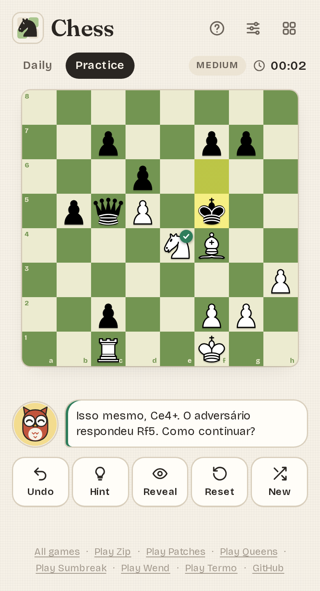
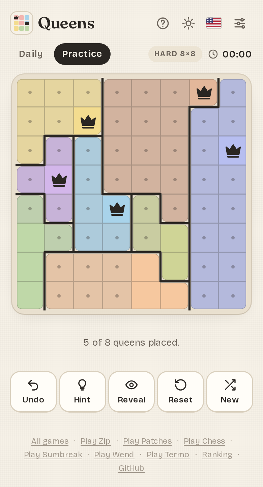
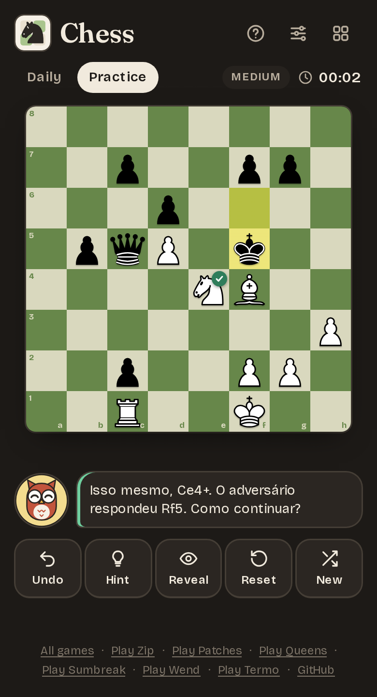
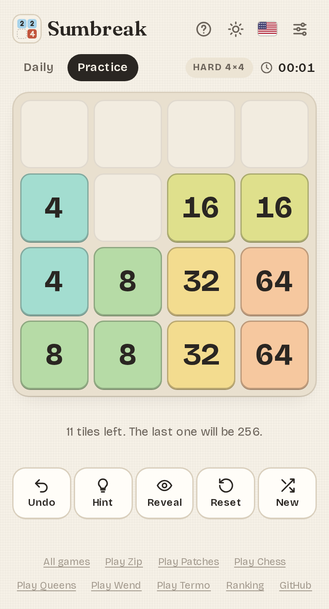
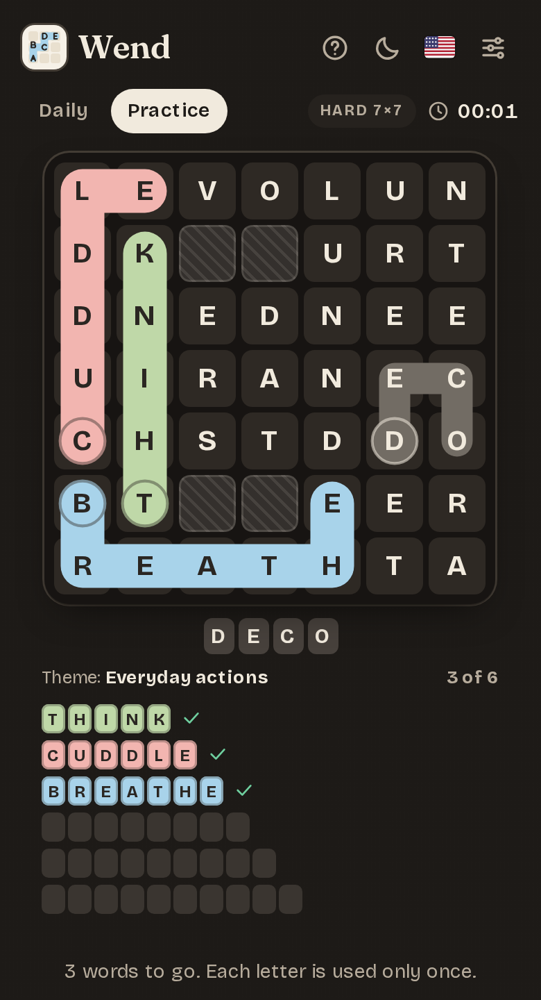

# play.brunosilva.io

<p align="center">
  <a href="https://play.brunosilva.io/">
    
  </a>
</p>

A small platform of daily logic puzzles, playable at [play.brunosilva.io](https://play.brunosilva.io/). It currently has seven games. Zip, Patches, Queens, Sumbreak and Wend are inspired by the LinkedIn games of the same name, Chess by the puzzles of chess.com and Lichess, and Termo by [term.ooo](https://term.ooo/):

- **Zip**: draw one path through every cell, passing the numbers in order.
- **Patches**: cover the grid with rectangles so that each one holds exactly one clue.
- **Chess**: solve a tactic from a generated game, with a coach who explains every move.
- **Queens**: place one queen in every row, column and coloured region so that no two touch.
- **Sumbreak**: merge equal neighbours into their sum, in the right order, until one tile is left.
- **Wend**: trace the hidden words of a theme through neighbouring letters until every letter is used. The words are in Portuguese.
- **Termo**: guess a hidden five-letter Portuguese word from the marks each guess gets. Dueto and Quarteto hide two and four words at once.

Every game gets one new board per day, the same for every player, plus unlimited practice. There is no server state. Puzzles are generated in the browser from a seed, and progress, streaks and best times stay on the device. The app installs as a PWA and plays offline after the first visit.

## Screenshots

<table>
  <tr>
    <th width="33%">Hub</th>
    <th width="33%">Zip</th>
    <th width="33%">Patches</th>
  </tr>
  <tr>
    <td></td>
    <td></td>
    <td></td>
  </tr>
</table>

<table>
  <tr>
    <th width="33%">Chess</th>
    <th width="33%">Queens</th>
    <th width="33%">Chess, dark theme</th>
  </tr>
  <tr>
    <td></td>
    <td></td>
    <td></td>
  </tr>
</table>

<table>
  <tr>
    <th width="33%">Sumbreak</th>
    <th width="33%">Sumbreak, dark theme</th>
    <th width="33%"></th>
  </tr>
  <tr>
    <td></td>
    <td></td>
    <td></td>
  </tr>
</table>

<table>
  <tr>
    <th width="33%">Wend</th>
    <th width="33%">Wend, dark theme</th>
    <th width="33%"></th>
  </tr>
  <tr>
    <td></td>
    <td></td>
    <td></td>
  </tr>
</table>

<table>
  <tr>
    <th width="33%">Termo</th>
    <th width="33%">Termo, dark theme</th>
    <th width="33%"></th>
  </tr>
  <tr>
    <td></td>
    <td></td>
    <td></td>
  </tr>
</table>

The interface follows the system theme:

<table>
  <tr>
    <td width="33%"></td>
    <td width="33%"></td>
    <td width="33%"></td>
  </tr>
</table>

The screenshots are not mockups. `npm run screenshots` plays every game against a running production build and saves what it sees.

## Routes

| Route | What it is |
|---|---|
| `/` | hub: every game, today's number and difficulty, your status and streak, countdown to the next boards |
| `/zip`, `/patches`, `/chess`, `/queens`, `/sumbreak`, `/wend`, `/termo` | today's puzzle |
| `/zip/practice` and the same under each game | pick a difficulty, a board size (Chess and Termo have one) and an optional seed |
| `/zip/play?seed=ZIP:lucky:1:hard:8` | an exact puzzle. The same seed always builds the same board, so links are shareable |

Old Zip links such as `/hard/42` redirect to the new practice route. The shortcut domains `zip.brunosilva.io` and `patches.brunosilva.io` redirect to their game on `play.brunosilva.io`.

## How the games work

**Zip.** Press 1 and drag. The path moves to side neighbours, cannot cross itself or a wall, and must reach the numbers in order. The board is solved when the path covers every cell and ends on the last number. Drag backwards to rewind, or tap a cell on the path to cut it there. Boards go from 5x5 to 8x8.

Boards are themed by their seed. Walls form figures (a cross, a frame, a face, a pinwheel), some cells are blocked and the path goes around them, and the solution is often a drawing of its own: a spiral, a meander, or a path whose second half mirrors the first. Hard and expert boards hide some numbers behind a `?`. When a board is solved, the walls fade out and the path stays, with the numbers on it.

**Patches.** Press a clue and drag outward to draw its patch. A clue can give a cell count, a shape (square, tall, wide or any), both, or nothing (it then shows `?`). Patches cannot overlap and every cell must be covered. A patch can be drawn in several strokes: a partial one stays on the board as unfinished, and another drag from the clue or from the patch adds to it. Tap a patch to remove it. Boards go from 5x5 to 10x10.

**Chess.** Every puzzle opens with the opponent's last move, which is either a mistake to punish or a threat to answer. Drag a piece, or tap it and then the square. Easy puzzles take one move (a mate in one, or a piece left hanging), and expert ones are mates in three. A move that is legal but wrong stays on the board with a cross, and the coach, an owl called Sofia, says what it allows: the piece it loses, the mate it walks into, the king it lets escape. She speaks Portuguese and never names the move to find. A tap on the board takes the wrong move back. The first hint shows which piece moves, the second plays the move.

Puzzles are not taken from a database. The generator plays a game against itself from the starting position and stops at the first move that can be punished in exactly one way, so every position can be reached in a real game.

**Queens.** Tap a cell once for an X, twice for a queen. Dragging marks X's. Every row, column and coloured region takes exactly one queen, and two queens cannot touch, diagonals included. A queen that breaks a rule against one already on the board is refused, and cells that placed queens rule out get a small dot. Boards go from 5x5 to 10x10.

**Sumbreak.** Drag a number onto a side neighbour that holds the same number, or tap one and then the other. The two become one tile with their sum, on the cell that was dropped on. The other cell stays empty and nothing slides, so a number that ends up away from its next partner is stranded for good. The board is solved when one tile is left. A merge that ruins the board is still played, and the game only says so when you get stuck or ask for a hint, which then takes the board back to the last position that can be finished. Boards go from 3x3 to 5x5.

**Wend.** The board is a grid of letters that hides the words of one theme, such as fruits or football, and the list under it shows how long each word is. Drag through neighbouring letters to trace a word. A word turns as often as it likes, never moves diagonally and goes around the walls. A trail stays on the board in grey whether it spells anything or not, and turns into colour when it is one of the hidden words. Together the words use every letter once, so the last word is whatever is left. Tap the first letter of a trail to erase it. The words are in Portuguese and are laid out without accents. Boards go from 5x5 to 8x8, and the two harder tiers keep the theme secret until the first word is found.

**Termo.** Type a five-letter Portuguese word and press Enter. Each letter is marked: right place, in the word but elsewhere, or not in the word. The on-screen keyboard keeps the best mark of every letter, and has keys to delete a letter and to clear the row. Accents are never typed: the game writes them when the row is played. The daily puzzle is always Termo: one word, six guesses. Dueto hides two words at once with seven guesses, and Quarteto four with nine. Each day has one Dueto and one Quarteto of its own, offered once the daily is over, and Practice has all three modes. A guess is final, so there is no undo and no reset, and running out of guesses ends the game.

Wend and Termo speak Portuguese on the board, in their messages and in their tutorials, because their words are Portuguese. The frame around them stays in English.

All games share the same controls and rules around the board:

- **Undo**, **Hint**, **Reveal** and **Reset**, plus **New** in practice mode, which loads another board and restarts the clock. A hint acts: it removes a mistake if there is one, otherwise it plays the next forced move and says why. Reveal plays the whole solution piece by piece, and that puzzle then earns no streak and no best time. Termo has only Hint and Reveal, because a guess is final. A finished practice puzzle also offers **Try again**: the same board from the start, with a fresh clock. A replay sets no best time, since the answer has been seen.
- **The clock** starts the first time you see the board and only stops when the puzzle ends. Closing the tab does not pause it.
- **Daily puzzles** change at midnight Pacific Time and get harder from Monday to Sunday, except in Termo, where the daily is the same game every day. Finishing one extends that game's streak.
- **Sound and vibration** are on by default and can be turned off in the settings, which apply to every game.
- Everything works with the keyboard, and the layout follows the system's light or dark theme and its reduced motion setting.

The game's mark at the top left leads back to the hub. Once a puzzle is under way it asks first, because the clock keeps running while you are away. The result screen suggests up to two games you have not finished today, and one more button leads to the hub for the rest.

Every generated puzzle has exactly one solution, proven by a solver before the board is shown, and Patches and Queens boards can always be solved by deduction alone. In Chess, "one solution" means one move at each step that mates in time or wins the material, checked by the engine's search. Sumbreak is the exception: many orders of merges solve a board, and the solver instead knows for every position whether it can still be finished. In Wend the hidden words fit on the board in exactly one way. Termo has nothing to prove: its puzzle is a word from a curated list. Zip measures how hard a board is by counting the wrong turns that only fail many cells later, and each difficulty aims for its own score.

## Project structure

```
src/
  app/        routes only
  games/      registry.ts, zip/, patches/, chess/, queens/, sumbreak/, wend/, termo/ (each: engine, components, hooks, storage)
  shared/     engine, storage, platform, hooks, ui: everything the games have in common
public/       service worker, manifest, icons
scripts/      CLI tools per game
tests/        Vitest unit and bulk generation tests
e2e/          Playwright tests against the production build
docs/         architecture, seeds, and one folder per game
```

A game imports `shared` and never another game. Each `engine/` folder is pure TypeScript with no React or DOM, so it also runs from the command line. `docs/ARCHITECTURE.md` explains the layers and lists the steps to add a game.

The stack is Next.js 16, React 19, TypeScript and Tailwind CSS 4, with no runtime dependencies beyond React and Next.js. That includes chess: the move generator, the search and the board are written here. Icons are hand-drawn SVG, sounds are synthesized with Web Audio, and the boards are DOM and SVG. The chess pieces are the Cburnett set from Wikimedia Commons, used under its BSD licence (notice in `docs/chess/CHESS.md`). Termo's word lists are built from [fserb/pt-br](https://github.com/fserb/pt-br), used under its MIT licence (notice in the generated files and in `docs/termo/TERMO.md`). Wend's themed word bank was written for this project.

## Getting started

```bash
git clone https://github.com/brunos3d/play.brunosilva.io.git
cd play.brunosilva.io
npm install
npm run dev
```

Open [http://localhost:3000](http://localhost:3000). In development each game shows a debug panel under the board with the seed, solver statistics and a switch that outlines the solution. The service worker only registers in production builds:

```bash
npm run build
npm start
```

## Commands

```bash
npm test                # Vitest: shared and every game, including bulk puzzle generation
npm run test:e2e        # Playwright: builds, serves and drives the production app
npm run lint
npm run typecheck
npm run icons           # render PNG icons from public/icons/*.svg
npm run og              # render the Open Graph images in public/og, once
npm run screenshots     # play every game on a running server and save the README screenshots

npm run zip:generate -- --seed 12345 --difficulty hard --solution
npm run zip:validate        # audits seeds, sizes and a year of dailies
npm run zip:benchmark

npm run patches:generate -- --seed 12345 --difficulty hard --solution
npm run patches:solve -- --seed 12345 --difficulty hard --steps
npm run patches:validate
npm run patches:benchmark

npm run chess:generate -- --seed 12345 --difficulty hard --solution
npm run chess:validate
npm run chess:benchmark

npm run queens:generate -- --seed 12345 --difficulty hard --solution --steps
npm run queens:validate
npm run queens:benchmark

npm run sumbreak:generate -- --seed 12345 --difficulty hard --solution
npm run sumbreak:validate
npm run sumbreak:benchmark

npm run wend:generate -- --seed 12345 --difficulty hard --solution
npm run wend:validate
npm run wend:benchmark

npm run termo:generate -- --seed 12345 --difficulty hard --solution
npm run termo:validate
npm run termo:benchmark
npm run termo:words -- --data <folder with the fserb/pt-br files>   # rebuild the word lists
```

The e2e tests need Chromium once: `npx playwright install chromium`.

## Documentation

- [Architecture](docs/ARCHITECTURE.md): layers, the shared game frame, the clock, persistence, the visual system, PWA
- [Seeds and daily puzzles](docs/SEEDS.md): determinism, seed format, versioning, Pacific time, streaks
- [Zip](docs/zip/ZIP.md): rules, solver, generator, tiers, interaction, benchmark
- [Chess](docs/chess/CHESS.md): engine, generator, recipes per tier, the coach, the board, benchmark
- [Chess and Queens research](docs/chess/RESEARCH.md): how chess.com, Lichess and LinkedIn do it, what was taken from each, and why no chess library is used
- [Queens](docs/queens/QUEENS.md): rules, solvers, generator, tiers, interaction, benchmark
- [Sumbreak](docs/sumbreak/SUMBREAK.md): how LinkedIn's game works, rules, solver, the difficulty measure, generator, benchmark
- [Wend](docs/wend/WEND.md): how LinkedIn's game works, the word bank, the one-solution check, generator, tiers, interaction
- [Termo](docs/termo/TERMO.md): how term.ooo works, rules, the word lists and their licence, tiers, interaction
- Patches: [reference notes](docs/patches/PATCHES_REFERENCE.md), [engine](docs/patches/PUZZLE_ENGINE.md), [generation](docs/patches/PUZZLE_GENERATION.md), [solver](docs/patches/SOLVER.md), [difficulty](docs/patches/DIFFICULTY.md)

## About

This project started as a single game. The first version of Zip was built with Claude Opus 4.6 as the AI coding assistant, in 10 prompts, as an experiment in how far iterative prompting could go. Patches, the shared platform, the rewrite of Zip on top of it, Chess, Queens, Sumbreak, Wend and Termo followed the same way.

Made by [Bruno Silva](https://brunosilva.io).

## License

MIT
